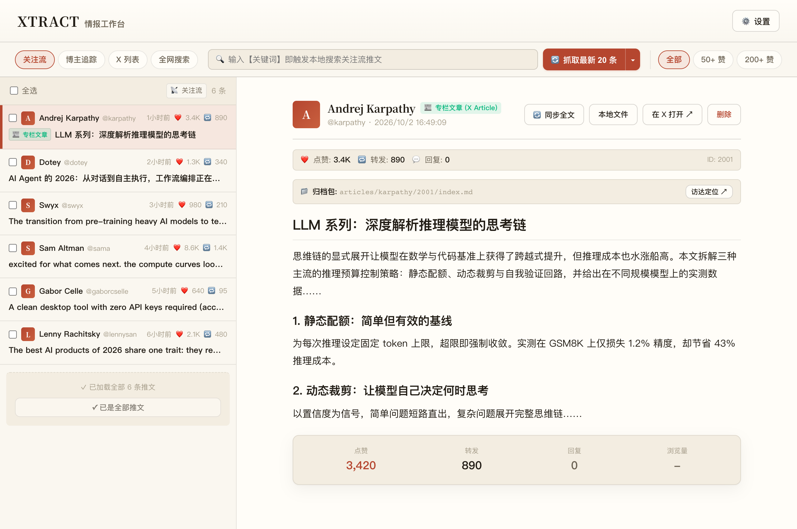
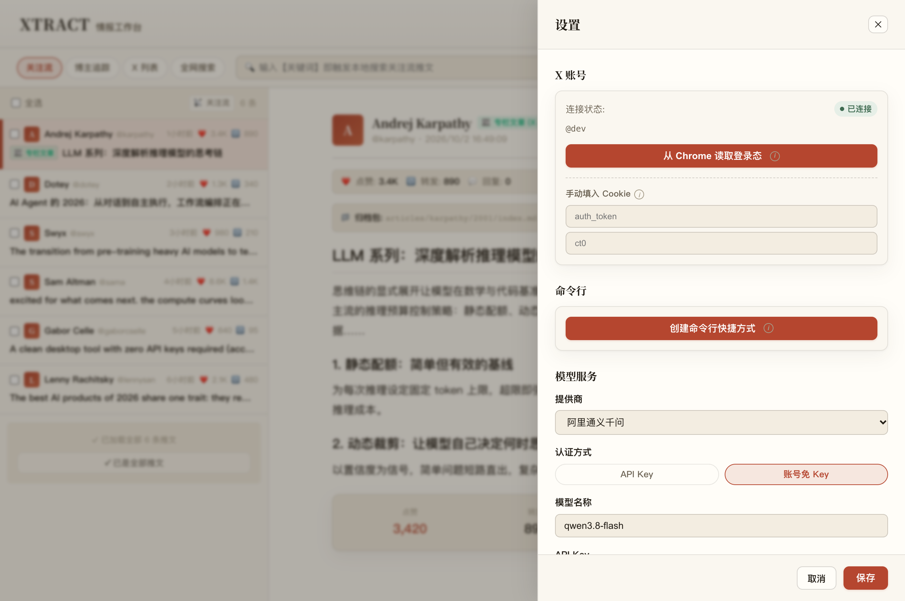

# 🗞️ Xtract - X (Twitter) Intelligence Radar & AI Digest

[](docs/prd/README.md)
[](LICENSE)
[](https://nodejs.org/)
[](https://www.typescriptlang.org/)
[](https://www.electronjs.org/)
[](https://vitest.dev/)

> **基于纯 HTTP SSR 秒级直取 + Electron 内置隐藏窗口无损网络流拦截 + SQLite 本地增量去重 + 全网实时热搜雷达 + 国内外多大模型统一调度（双轨认证：API-Key / 账号订阅免 Key）的个人情报与深度研报系统。**

---

## 这是什么

传统的 Twitter 爬虫依赖逆向库（`twikit` 之类），而 X 官方每次重构前端打包命名就会让它们暴毙。Xtract 反过来做：**单推 / X Article 直接通过纯 HTTP SSR 秒级直取（零弹窗、零浏览器），时间线与热搜则通过 Electron 内置隐藏窗口在协议层监听 X 官方前端的 SSR 与 GraphQL 响应**。只要你能用浏览器刷推，抓取就一定能用。

同一套代码提供两种运行形态：

- **桌面工作台**（Electron）：无参启动即唤出「XTRACT 情报工作台」——五维情报源切换（关注流 / 推荐流 / 博主追踪 / X 列表 / 全网搜索）、单行类型筛选与四维排序、长文沉浸阅读、视频流式在线播放与本地离线下载；
- **Headless CLI**：带参启动，stdout 输出标准 JSON，可直接接入终端管道与下游 Agent。

| 情报工作台 | 设置中心 |
| :---: | :---: |
|  |  |

| 能力 | 说明 |
| :--- | :--- |
| **零弹窗抗脆弱抓取** | 单推纯 HTTP SSR ~1s 同步；时间线复用 Electron 内置隐藏窗口（零外部弹窗），全面兼容 X `x-web` 新版载荷 |
| **五维情报源** | 关注流 / 推荐流 (For You) / 博主追踪 / X 列表 / 全网搜索，协议级与存储级严格隔离互不串台 |
| **高信噪比筛选与排序** | 点赞门槛 + 拉取内容类型多选（默认仅抓 X Article）+ 侧栏单行类型筛选（专栏/长推/短推）与四维排序（发布/抓取/点赞/浏览） |
| **抓取与总结解耦** | 推文先落库去重，LLM 按需处理；改 Prompt 重出早报是本地秒级操作，不重爬、不烧 Token |
| **自包含归档与本地视频** | 导出为 `articles/{作者}/{推文ID}/index.md` + `images/` + `videos/`，支持按需流式下载 MP4 与 `xtract-media://` 离线秒播 |
| **7 大模型统一调度** | Gemini / OpenAI / DeepSeek / 千问 / 智谱 / MiniMax / Kimi，支持 API-Key 与账号订阅免 Key 双轨认证 |

---

## 下载安装（推荐）

从 [GitHub Releases](https://github.com/monkeychen/xtract/releases/latest) 下载对应平台的安装包：

| 平台 | 产物 | 说明 |
| :--- | :--- | :--- |
| macOS (Apple Silicon) | `Xtract-x.x.x-arm64.dmg` | 首次打开若被 Gatekeeper 拦截：右键 → 打开 |
| Windows x64 | `Xtract-Setup-x.x.x.exe` | 无代码签名，SmartScreen 拦截时点「更多信息 → 仍要运行」 |

安装后：打开应用 → ⚙️ 设置 → 「从 Chrome 读取登录态」（macOS）配置凭据 → 「命令行」区一键创建 `xtract` 命令。完整说明见下方「安装后用户」章节。

> 平台能力差异：浏览器登录态导入仅支持 macOS；Windows 用户请用设置里的「手动填入 Cookie」。Windows 支持随 v0.1.0 首发，安装/快捷方式链路欢迎反馈问题。

---

## 5 分钟快速开始（开发者）

**前置**：Node.js ≥ 22、已安装 Chrome、本地可用的网络代理（抓取 X 必需）。

```bash
git clone https://github.com/monkeychen/xtract.git
cd xtract
pnpm install
pnpm exec playwright install chromium
```

### 1. 配置凭据

复制 `.env.example` 为 `.env`，最少需要三项：

```bash
# X 会话凭据（在浏览器登录 X 后，从 x.com 的 cookie 中取 auth_token 与 ct0）
X_AUTH_TOKEN=your_auth_token
X_CT0=your_ct0

# 网络代理（抓取 X 的前提）
HTTP_PROXY=http://127.0.0.1:7890

# 大模型（二选一：API Key 或账号订阅通道）
LLM_PROVIDER=gemini
LLM_API_KEY=your_api_key
```

也可以不碰 `.env`，直接 `pnpm dev` 后在设置抽屉里配置；macOS 用户可在设置中心点击「从 Chrome 读取登录态」一键导入日常浏览器中的既有会话，**无需用开发者工具手动查 Token**（Windows 用户可在设置中手动填入 `auth_token` / `ct0`）。

完整的凭据说明、各模型厂商端点解析规则（`XXXX_BASE_URL`）与免 Key 账号通道用法，见 [docs/configuration.md](docs/configuration.md)。

### 2. 跑起来

```bash
pnpm dev          # 启动桌面工作台
pnpm dev:cli -- --help   # 查看全部命令行选项
```

> **装的是 DMG 而不是源码？** 见下方「命令行」章节——安装后无需 pnpm，
> 直接执行应用二进制即可：`/Applications/Xtract.app/Contents/MacOS/Xtract --help`。

---

## 命令行（CLI）

Xtract 的桌面应用与命令行是**同一个程序**：

- **不带参数**启动 → 打开情报工作台窗口
- **带参数**启动 → 进入命令行模式，stdout 输出纯 JSON（加 `--json`）

### 安装后用户（无 pnpm / Node）

DMG 安装后即可直接使用，**不需要安装任何开发工具**。

**推荐方式**：打开应用 → ⚙️ 设置 → 「命令行」→ 点击**创建命令行快捷方式**。一键在 `~/bin` 下创建 `xtract` 命令并自动配置 PATH，新开终端即可使用。Windows 安装版同样支持（`~/bin/xtract.cmd` + 用户 PATH）。

也可以直接用完整路径执行：

```bash
# 先打开「终端」，再执行（下面两行按需替换为你的实际安装路径）
XT="/Applications/Xtract.app/Contents/MacOS/Xtract"

"$XT" --help            # 查看全部选项
"$XT" --version         # 查看版本
"$XT" --list 20         # 检索本地已抓推文
```

### 开发者（源码运行）

```bash
pnpm dev:cli -- --help
```

### 速查表

下表 `XT` 代表可执行文件路径（安装用户）或 `pnpm dev:cli --`（开发者）。

| 目的 | 命令 |
| :--- | :--- |
| 拉取关注流（仅入库） | `XT --fetch-only --limit 20` |
| 拉取推荐流 (For You) | `XT --recommended --limit 20` |
| 离线生成今日早报 | `XT --report-only --hours 24` |
| 关键词全网实时搜索（含短/长推） | `XT --search "AI Agent" --content-types article,note,short --min-likes 50` |
| 抓取某博主全部推文 | `XT --user karpathy --all-tweets` |
| 抓取指定 X 列表 | `XT --x-list 2100985900734062922` |
| 查看/同步单篇推文并下载视频 | `XT --view <推文ID或URL> --download-videos` |
| 全网热搜趋势看板 | `XT --trends` |
| 全自动趋势深度研报 | `XT --trends-digest --hours 24` |
| 检索本地已抓推文 | `XT --list 50` |
| 导出 Markdown 清单归档 | `XT --export 50` |
| 按 ID 批量导出独立归档 | `XT --export-ids <ID1> <ID2>` |
| 级联删除（库 + 磁盘，可批量） | `XT --delete <ID1> <ID2>` |
| 验证会话连通性 | `XT --check-auth` |
| 导入 X 登录态 | 桌面端「设置 → X 账号 → 从 Chrome 读取登录态」 |

CLI 输出的提示里会直接打印当前可用的完整命令，复制即可执行。
全部参数、示例与工作流场景见 **[docs/cli-reference.md](docs/cli-reference.md)**。

---

## 数据落在哪

默认统一存储在 `~/Documents/Xtract/`（可在设置中自定义存储根目录，开发态与安装版共享同一数据目录）：

```
~/Documents/Xtract/
├── config.env           # 持久化设置（模型 Key、代理、内容类型与自动下载偏好）
├── data/
│   ├── tweets.db        # SQLite 主库，tweet_id 主键增量去重
│   ├── auth_state.json  # X 会话状态（可选）
│   └── raw/             # 原始 GraphQL 快照备份，便于事后回溯
├── articles/
│   └── {作者}/{推文ID}/ # 自包含 Page Bundle：index.md + images/ + videos/
└── reports/             # AI 早报与趋势研报（YYYY-MM-DD.md / trends_YYYY-MM-DD.md）
```

目录规范、表结构与级联删除语义见 [docs/operations.md](docs/operations.md)。

---

## 文档索引

| 文档 | 内容 |
| :--- | :--- |
| [docs/cli-reference.md](docs/cli-reference.md) | CLI 完整命令手册、参数详解、典型工作流 |
| [docs/configuration.md](docs/configuration.md) | X 凭据、代理、多模型端点与双轨认证配置 |
| [docs/operations.md](docs/operations.md) | 定时任务配置（cron / launchd）、存储架构、FAQ |
| [docs/architecture.md](docs/architecture.md) | 系统总体架构：分层拓扑、端到端数据流时序、技术选型 |
| [docs/detailed_design.md](docs/detailed_design.md) | 详细设计：接口契约、防抖状态机、免 Token 会话捕获、模型端点字典 |
| [docs/vibe-coding-log.md](docs/vibe-coding-log.md) | 开发演进复盘与真实踩坑记录 |
| [docs/design-system.md](docs/design-system.md) | 暖色编辑杂志风 UI 设计系统（可移植到其他项目） |
| [docs/prd/](docs/prd/) | 版本化产品需求：v0.1.0 已交付规格 / v0.2.0 演进路线图 |

参与开发前，请先阅读 [CLAUDE.md](CLAUDE.md)（工程宪法与 AI 协同基线）。

---

## 开发与质量门禁

```bash
pnpm verify          # 一键门禁：lint + test + tsc + build + 打包 smoke
```

门禁明细：

```bash
pnpm lint            # 代码风格门禁
pnpm test            # 单元 + 集成 + E2E 自动化测试
npx tsc --noEmit     # 静态类型门禁
pnpm build           # 生产构建门禁（vite + Electron 主进程/预加载编译）
pnpm pack:dir && pnpm smoke  # 打包门禁：对真实 Xtract.app 产物验证 GUI/CLI 三种启动形态
```

全部门禁全绿方可交付。当前覆盖 **376 项自动化用例**，含 **25 个真实浏览器 Playwright E2E 流程**（启动真实 Vite + Chrome，注入契约 IPC 桥，断言真实 DOM 与状态契约）。

---

## License

[Apache-2.0](LICENSE)。欢迎自由使用、分发与修改；商业使用与二次开发请保留原作者版权声明及免责声明。
